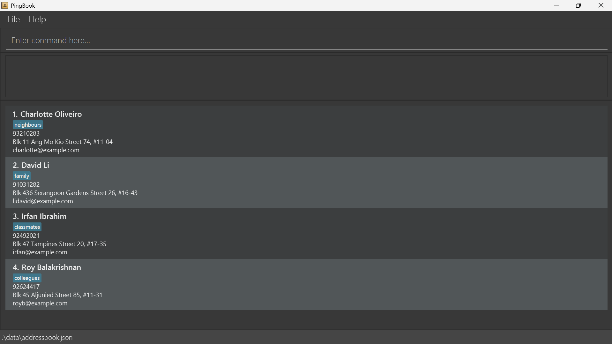

# PingBook User Guide

PingBook is a **desktop application for managing contacts, optimized for use through a Command Line Interface (CLI)** while retaining the benefits of a Graphical User Interface (GUI). If you type quickly, PingBook can help you manage contacts faster than traditional GUI applications.

<!-- * Table of Contents -->
<page-nav-print />

--------------------------------------------------------------------------------------------------------------------

## Quick start

1. Ensure that Java `25` or later is installed on your computer. 
   **Mac users:** Ensure you have the precise JDK version prescribed [here](https://se-education.org/guides/tutorials/javaInstallationMac.html).

1. Download the latest `.jar` file from [here](https://github.com/AY2627S1-CS2103T-W13-4/tp/releases).

1. Copy the file to the folder you want to use as the _home folder_ for your PingBook.

1. Open a terminal, `cd` to the folder containing the JAR file, and run `java -jar pingbook.jar`. 
   A GUI similar to the one below should appear in a few seconds. Note how the app contains some sample data. 
   

1. Type a command in the command box and press Enter to execute it. For example, type **`help`** and press Enter to open the help window. 
   Some example commands you can try:

   * `listc t/colleague` : Lists all contacts that have the tag `colleague`.

   * `addc n/John Doe p/98765432 e/johnd@example.com a/John street, block 123, #01-01` : Adds a contact named `John Doe` to PingBook.

   * `deletec 3` : Deletes the 3rd contact shown in the current list.

   * `clear` : Deletes all contacts.

   * `exit` : Exits the app.

1. Refer to the [Features](#features) section below for details of each command.

--------------------------------------------------------------------------------------------------------------------

## Features

<box type="info" seamless>

**Notes about the command format:** 

* Words in `UPPER_CASE` are the parameters to be supplied by the user. 
  For example, in `addc n/NAME`, replace `NAME` with a value such as `John Doe`.

* Items in square brackets are optional. 
  For example, `n/NAME [t/TAG]` can be used as `n/John Doe t/friend` or as `n/John Doe`.

* Items followed by `...` can appear zero or more times. 
  For example, `[t/TAG]... ` may be omitted, or written as `t/friend` or `t/friend t/family`.

* Parameters can be in any order. 
  For example, if the command specifies `n/NAME p/PHONE_NUMBER`, `p/PHONE_NUMBER n/NAME` is also acceptable.

* Extra parameters that are defined by PingBook but not used for the command are rejected. For example, `deletec 1 t/friend` is invalid.

* Extra parameters for commands that take no parameters, such as `help`, `exit`, and `clear`, are ignored. 
  For example, `help 123` is interpreted as `help`.

* If you are using a PDF version of this document, be careful when copying and pasting commands that span multiple lines as space characters surrounding line-breaks may be omitted when copied over to the application.
</box>

### Viewing help: `help`

Shows a message explaining how to access the help page.

Format: `help`

### Adding a person: `addc`

Adds a person to PingBook.

Format: `addc n/NAME p/PHONE_NUMBER e/EMAIL [a/ADDRESS] [t/TAG]... `

<box type="tip" seamless>

**Tip:** A person can have any number of tags, including zero. The address is optional and can be left out.
</box>

Examples:
* `addc n/John Doe p/98765432 e/johnd@example.com a/John street, block 123, #01-01`
* `addc n/Mary Lim p/87654321 e/marylim@example.com t/premium` (no address)
* `addc n/Betsy Crowe t/friend e/betsycrowe@example.com a/Newgate Prison p/1234567 t/criminal`

### Listing and filtering clients: `listc`

Shows a list of all persons in PingBook that match the given tags.

Format: `listc [t/TAG]...`

* `TAG` is optional and there can be multiple tags.
* Tags are alphanumeric and use case-insensitive matching.
* The command will only accept `TAG` fields. Other fields such as `NAME`, `DATE` are rejected.
* The command is case-sensitive. `listC` or `Listc` are considered invalid.
* A person is shown only if they have all the tags given.
* If there are no tags provided, PingBook will display all persons and a success message detailing the number of persons listed.
* If there are tags provided, PingBook will display all matching persons and a success message detailing the number of persons listed and the tags given.

Examples:
* `listc`
* `listc t/friend t/colleagues`

### Adding a meeting: `addm`

Adds a meeting to PingBook and displays the Meetings panel.

Format: `addm n/NAME d/DATE st/START_TIME et/END_TIME [t/TAG]... [force/]`

* Name, date, start time and end time are required, and each of their prefixes can be used only once.
* `NAME` can contain only letters, spaces, hyphens (`-`), and apostrophes (`'`). It must contain at least one letter.
* `DATE` must be a valid calendar date in `DD/MM/YYYY` format.
* `START_TIME` and `END_TIME` must each use the 24-hour `HHMM` format, from `0000` to `2359`.
  `END_TIME` must be later than `START_TIME`.
* If the new meeting overlaps an existing meeting on the same date, it is not added and the error lists the
  conflicting meetings. Add `force/` (with no value, and used at most once) to add it anyway; the success message
  then ends with a warning listing the overlapping meetings. Using `force/` when nothing overlaps has no effect.
* Meetings overlap when they are on the same date and their time ranges intersect. A meeting that starts exactly
  when another ends (for example `1400`-`1500` and `1500`-`1600`) does not overlap. Finished meetings are included.
* Tags are optional. Use one `t/TAG` per tag; tag names must contain only letters and digits, with no spaces.
  Repeated identical tags are stored once. Tag names are case-sensitive, as with client tags.
* Tags appear on the meeting card and are saved with the meeting. Older saved meetings without tags still load normally.
* Adding a meeting clears any active meeting filter so the new meeting is visible.
* A meeting is considered a duplicate if its name, date, start time, and end time are the same as those of an
  existing meeting, regardless of tags. Name comparison is case-insensitive, and repeated spaces in names are ignored.

Examples:
* `addm n/Project Review d/08/10/2026 st/1400 et/1500`
* `addm d/14/10/2026 n/Client Check-in et/1030 st/0930`
* `addm n/Project Review d/25/10/2026 st/1400 et/1500 t/urgent t/work`
* `addm n/Late Call d/08/10/2026 st/1430 et/1530 force/` adds the meeting even if it overlaps an existing one.

### Listing and filtering meetings: `listm`

Shows all saved meetings in the Meetings panel, with numbered rows containing the name, date, start/end times and tags.

Format: `listm [t/TAG]...`

* Plain `listm` displays all meetings and clears any previous meeting filter.
* Supply one or more `t/TAG` arguments to display meetings containing **all** supplied tags.
  Matching uses complete tag names and ignores case: `t/urgent` matches `Urgent`, but does not match `urgentMeeting`.
* Each invocation replaces the previous filter. Repeated tags do not change the results.
* Tag names must contain only letters and digits. Empty tags (`listm t/`) are rejected.
* Leading and trailing whitespace is ignored. Other arguments such as `listm 1` and `listm --all` are rejected.
* The command is case-sensitive. `Listm` and `LISTM` show `Unknown command. Did you mean "listm"?`.
* Ongoing and upcoming meetings appear first, ordered by date and start time.
  Finished meetings follow, also ordered from earliest to latest.
* A meeting is finished when its end time on its date is at or before the current local time on your computer.
  To refresh this grouping as time passes while retaining a tag filter, repeat the command with the same tag arguments.
  For example, after `listm t/work`, run `listm t/work` again. Running plain `listm` refreshes the grouping and clears
  the active tag filter, showing all meetings.
* Equal start times are ordered by end time, then name. Sorting does not change the order of records in the data file.
* An empty list displays `No meetings to display.`. Plain `listm` reports `Listed all meetings.`.
  A filtered list reports `Listed N meeting(s) matching all specified tags.`, including zero when no meetings match.
* Filtering only changes the display; all meetings remain saved. `editm` and `deletem` use the displayed row numbers.
  Editing tags can hide a meeting if it no longer matches the active filter. Deleting or editing keeps that filter active.
* Duplicate meetings are prevented by the shared model and rejected when loading data. Duplicates have the same
  name (ignoring case and repeated spaces), date, start time and end time; `listm` does not delete stored records.
* Use `listc` to return to the contacts panel. `help` and invalid commands keep the currently selected panel.
* Contact commands `deletec INDEX` and `editc INDEX ...` are rejected while the Meetings panel is active.
  Run `listc` to display contacts before editing or deleting them. You can also use `findc KEYWORD` to display
  matching contacts and then use the indices in those results.

Examples:
* `listm t/urgent` displays meetings tagged `urgent`, ignoring case.
* `listm t/urgent t/work` displays meetings containing both tags.
* `listm` returns to the complete meeting list.

### Editing a meeting: `editm`

Edits an existing meeting in PingBook.

Format: `editm MEETING_INDEX [n/NAME] [d/DATE] [st/START_TIME] [et/END_TIME] [t/TAG]... [force/]`

* Edits the meeting at the specified `MEETING_INDEX` in the displayed meeting list.
* The Meetings panel must be active. Run `listm` before editing a meeting.
* The index must be a positive integer: 1, 2, 3, ...
* At least one field must be provided. Each prefix except `t/` can be used only once.
* Fields that are not provided keep their existing values.
* Names, dates, times, and tags follow the same validation rules as `addm`.
* When editing tags, all existing tags are replaced; adding tags is not cumulative.
* To remove all tags, enter `t/` without a tag after it.
* An edit that would make two meetings identical is rejected.
* The edited meeting must still end after it starts, and it is checked for overlaps with the other meetings (not
  with its own previous version) in the same way as `addm`. Add `force/` to save an overlapping edit anyway.
* Editing a meeting's date or time may move it to a different position in the sorted meeting list.

Examples:
* `editm 1 d/25/10/2026` changes only the date of the 1st displayed meeting.
* `editm 2 n/Client Review st/1500 et/1600` changes the name and times of the 2nd displayed meeting.
* `editm 3 t/urgent t/work` replaces all tags of the 3rd displayed meeting with `urgent` and `work`.
* `editm 1 t/` removes all tags from the 1st displayed meeting.

### Editing a person: `editc`

Edits an existing person in PingBook.

Format: `editc INDEX [n/NAME] [p/PHONE] [e/EMAIL] [a/ADDRESS] [t/TAG]... `

* Edits the person at the specified `INDEX`. The index refers to the index number shown in the displayed person list. The index **must be a positive integer** 1, 2, 3, ...
* The contacts panel must be active. If you are viewing meetings, run `listc` or `findc KEYWORD` first.
* At least one of the optional fields must be provided.
* Existing values will be updated to the input values.
* When editing tags, all of the person's existing tags are removed; adding tags is not cumulative.
* To remove all of a person's tags, enter `t/` without a tag after it.

Examples:
*  `editc 1 p/91234567 e/johndoe@example.com` Edits the phone number and email address of the 1st person to be `91234567` and `johndoe@example.com` respectively.
*  `editc 2 n/Betsy Crower t/` Edits the name of the 2nd person to be `Betsy Crower` and clears all existing tags.

### Locating persons by name: `findc`

Finds persons whose names contain any of the given keywords.

Format: `findc KEYWORD [MORE_KEYWORDS]`

* The search is case-insensitive; for example, `hans` matches `Hans`.
* Keyword order does not matter; for example, `Hans Bo` matches `Bo Hans`.
* The search considers only names.
* Partial words match; for example, `Han` matches `Hans`.
* Persons matching at least one keyword are returned (an `OR` search); for example, `Hans Bo` returns `Hans Gruber` and `Bo Yang`.

Examples:
* `findc John` returns `john` and `John Doe`
* `findc alex david` returns `Alex Yeoh`, `David Li` 
  

### Deleting a person: `deletec`

Deletes the specified person from PingBook.

Format: `deletec INDEX`

* Deletes the person at the specified `INDEX`.
* The index refers to the index number shown in the displayed person list.
* The contacts panel must be active. If you are viewing meetings, run `listc` or `findc KEYWORD` first.
* The index **must be a positive integer** 1, 2, 3, ...

Examples:
* `listc` followed by `deletec 2` deletes the 2nd person in PingBook.
* `findc Betsy` followed by `deletec 1` deletes the 1st person in the results of the `findc` command.

### Deleting a meeting: `deletem`

Deletes the specified meeting from PingBook.

Format: `deletem MEETING_INDEX`

* Deletes the meeting at the specified `MEETING_INDEX`.
* The command is case-sensitive. Only `deletem` in lowercase is accepted. `DeleteM` and other variations show `Unknown command.`.
* The index refers to the index number shown in the displayed meeting list.
* The index **must be a positive integer** 1, 2, 3, ...
* Invalid index show `The index is invalid.`.
* `deletem` can only be executed when the meeting list is shown. Run `listm` before attempting to delete meetings.

Examples:
* `deletem 2` deletes the 2nd meeting in the meeting list.

### Clearing all entries: `clear`

Clears all entries from PingBook.

Format: `clear`

### Exiting the program: `exit`

Exits the program.

Format: `exit`

### Saving the data

PingBook automatically saves data after every command. You do not need to save manually.

### Editing the data file

PingBook data is saved automatically as a JSON file `[JAR file location]/data/addressbook.json`. Advanced users are welcome to update data directly by editing that data file.

<box type="warning" seamless>

**Caution:**
If your changes make the data file invalid, PingBook starts with an empty address book at the next run. The invalid file remains on disk until you run a command (PingBook saves after every command). Still, we recommend backing up the file before editing it. 
Furthermore, certain edits can cause PingBook to behave in unexpected ways (e.g., if a value entered is outside of the acceptable range). Therefore, edit the data file only if you are confident that you can update it correctly.
</box>

--------------------------------------------------------------------------------------------------------------------

## FAQ

**Q**: How do I transfer my data to another computer? 
**A**: Install the app on the other computer and overwrite the data file it creates with the data file from your previous PingBook home folder.

--------------------------------------------------------------------------------------------------------------------

## Known issues

1. **When using multiple screens**, if you move the application to a secondary screen, and later switch to using only the primary screen, the GUI will open off-screen. The remedy is to delete the `preferences.json` file created by the application before running the application again.
2. **If you minimize the Help Window** and then run the `help` command (or use the `Help` menu, or the keyboard shortcut `F1`) again, the original Help Window will remain minimized, and no new Help Window will appear. The remedy is to manually restore the minimized Help Window.

--------------------------------------------------------------------------------------------------------------------

## Command summary

Action     | Format, Examples
-----------|----------------------------------------------------------------------------------------------------------------------------------------------------------------------
**Add client**    | `addc n/NAME p/PHONE_NUMBER e/EMAIL [a/ADDRESS] [t/TAG]... `   e.g., `add n/James Ho p/22224444 e/jamesho@example.com a/123, Clementi Rd, 1234665 t/friend t/colleague`
**Add meeting**    | `addm n/NAME d/DATE st/START_TIME et/END_TIME [t/TAG]... [force/]`   e.g., `addm n/John Doe d/20/09/2026 st/1430 et/1530 t/work`
**Clear**  | `clear`
**Delete client** | `deletec CLIENT_INDEX`  e.g., `deletec 3`
**Delete meeting** | `deletem MEETING_INDEX`  e.g., `deletem 3`
**Edit client**   | `editc INDEX [n/NAME] [p/PHONE_NUMBER] [e/EMAIL] [a/ADDRESS] [t/TAG]... `  e.g.,`editc 2 n/James Lee e/jameslee@example.com`
**Edit meeting** | `editm MEETING_INDEX [n/NAME] [d/DATE] [st/START_TIME] [et/END_TIME] [t/TAG]... [force/]`  e.g., `editm 2 d/25/10/2026 st/1500 et/1600 t/urgent`
**Find**   | `find KEYWORD [MORE_KEYWORDS]`  e.g., `find James Jake`
**List clients**   | `listc [t/TAG]...`  e.g., `listc t/colleague t/friend`
**List meetings** | `listm [t/TAG]...`  e.g., `listm t/urgent t/work`
**Help**   | `help`
